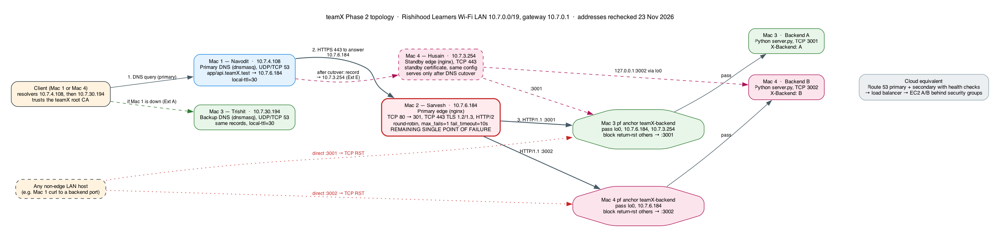
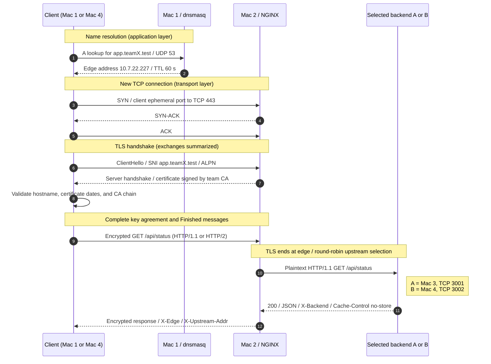
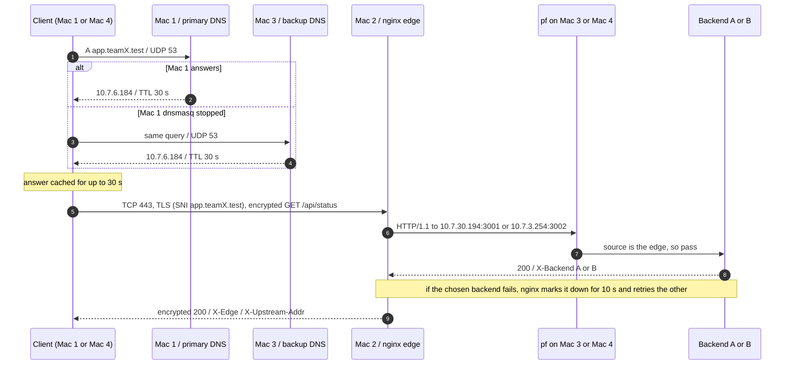

# CN Project - Team Architecture (`teamX`)

Sections 1 to 9 describe the Phase 1 baseline as reviewed, with the addresses
recorded on 28 September 2026. [Section 10](#10-phase-2-architecture) describes
what Phase 2 added: backup DNS, a 30-second TTL, backend firewall isolation,
failover behaviour, a standby edge, and the remaining single point of failure.
It uses the addresses rechecked on 23 November 2026.

## 1. System purpose

This project demonstrates a small private-network service built from four Macs:
private DNS, an HTTPS edge and load balancer, and two HTTP backends. A client
resolves a team hostname, connects securely to the edge, and receives a
response from one of the backends. The design models private DNS, an
application load balancer, and two application-server targets in a cloud
system.

All four Macs participate in the same system. Mac 4 also acts as a convenient
client and packet-capture vantage because its DNS queries cross the LAN to
Mac 1; that capture role does not change the shared architecture.

## 2. Team roles and services

| Mac   | Owner   | Team responsibility                                                                            | Main service             |
| ----- | ------- | ---------------------------------------------------------------------------------------------- | ------------------------ |
| Mac 1 | Navodit | Private DNS, DNS client checks, DNS failure demos                                              | `dnsmasq`, UDP/TCP 53    |
| Mac 2 | Sarvesh | Edge proxy, round-robin load balancing, TLS and team CA                                        | `nginx`, TCP 80/443      |
| Mac 3 | Trishit | Backend A, shared backend implementation, caching design                                       | Python backend, TCP 3001 |
| Mac 4 | Husain  | Backend B, second client, client-side load-balancing checks, protocol capture, wrong-port demo | Python backend, TCP 3002 |

The backend source is shared: the same `server.py` runs as A or B, selected
with environment variables. Each team member owns their assigned service and
supports the integration checks needed by the full request path.

## 3. Network topology

Editable source: [topology.dot](topology.dot). The diagram shows the current
Phase 2 network; [section 10](#10-phase-2-architecture) explains the parts
Phase 2 added. The Phase 1 roles are unchanged inside it. The four Macs must
share one private LAN. Mac 1 provides DNS, Mac 2 is the HTTPS edge, and Mac 3
and Mac 4 are the two upstream application servers. Clients connect to the edge
by hostname rather than selecting a backend directly.

## 4. Shared IP and service table

These are the Phase 1 values. The current addresses are in
[section 10.2](#102-current-ip-and-service-table) and [ip_table.md](ip_table.md).

| Mac   | Person  | Role               | Interface | IPv4            | Prefix / mask         | Gateway          | MAC address         | Listening ports |
| ----- | ------- | ------------------ | --------- | --------------- | --------------------- | ---------------- | ------------------- | --------------- |
| Mac 1 | Navodit | DNS + client       | `en0`     | `10.7.10.22`  | `/19 (255.255.224.0)` | `10.7.0.1` | `10:9f:41:bc:ff:5a` | `53 UDP/TCP`    |
| Mac 2 | Sarvesh | Edge / LB / TLS    | `en0`     | `10.7.22.227` | `/19 (255.255.224.0)` | `10.7.0.1` | `3a:33:4b:89:be:dc` | `80, 443 TCP`   |
| Mac 3 | Trishit | Backend A          | `en0`     | `10.7.18.190`  | `/19 (255.255.224.0)` | `10.7.0.1` | `be:4f:1d:91:b1:8b` | `3001 TCP`      |
| Mac 4 | Husain  | Backend B + client | `en0`     | `10.7.24.166` | `/19 (255.255.224.0)` | `10.7.0.1` | `6e:5a:77:e4:01:0c` | `3002 TCP`      |

Values recorded on the Rishihood Learners network on 28 September 2026.
Mac 2's IPv4, `/19` prefix (`255.255.224.0`), gateway `10.7.0.1` and MAC come
from its own `ifconfig en0` and `route -n get default`. The other three MAC
addresses are the active Wi-Fi addresses seen in Mac 2's ARP table
(`arp -n <IP>`); each owner should confirm theirs with `ifconfig en0`.
Recheck all values if any Mac rejoins or changes network.
The full editable table and collection commands are in [ip_table.md](ip_table.md).

## 5. Components and request path

The sequence follows a client request through DNS, TCP, TLS, and HTTP. It
shows a fresh DNS lookup and a new connection; cached DNS answers can skip
the lookup, and an established TCP/TLS connection can carry later requests.
TLS exchanges are summarized because the exact message order and certificate
visibility differ between TLS 1.2 and TLS 1.3.

### Name resolution and connection setup

[dnsmasq-teamX.conf](../02_config/dnsmasq-teamX.conf) listens on Mac 1
(`10.7.10.22`) and returns `10.7.22.227` for both `app.teamX.test` and
`api.teamX.test`, with `local-ttl=60`. The two names enter the same Nginx
server block and backend pool. DNS identifies the edge; it does not choose
Backend A or Backend B. When Mac 1 is itself the client, its DNS lookup may
stay local; Mac 4 provides the LAN DNS-capture vantage.

The client then connects from an ephemeral TCP port to Mac 2 on port 443.
SYN, SYN-ACK, and ACK establish the connection before TLS begins. The TLS
ClientHello carries the hostname in SNI and advertises supported application
protocols through ALPN. The edge presents a certificate signed by the team
root CA. The client checks the hostname, validity period, and certificate
chain before sending the application request. Nginx enables HTTP/2 for
compatible clients; HTTP/1.1 remains available.

### Forwarding and response

Nginx terminates TLS and forwards `GET /api/status` over a separate plaintext
HTTP/1.1 connection to `10.7.18.190:3001` (A) or `10.7.24.166:3002` (B).
Round-robin selection and passive failure handling belong to the edge. The
backend receives the incoming `Host` and configured forwarding headers;
its TCP peer is Mac 2.

The backend returns HTTP 200, JSON identifying A or B, `X-Backend`, and
`Cache-Control: no-store`. Nginx adds `X-Edge` and `X-Upstream-Addr` and sends
the response through the client's TLS connection. For `/api/cached`, the
backend instead sends cache headers and an ETag; a matching conditional
request receives 304 without a body.

| Protocol | Layer in this project | Connection or purpose |
| --- | --- | --- |
| DNS | Application | Client to Mac 1, normally UDP 53; DNS also supports TCP 53 |
| TCP | Transport | Client ephemeral port to edge 443; separate edge connection to backend 3001/3002 |
| TLS | Above TCP, below HTTP; commonly mapped to OSI session/presentation | Certificate validation and encryption on the client-to-edge hop |
| HTTP | Application | HTTP/1.1 or HTTP/2 inside client TLS; HTTP/1.1 from edge to backend |
| IP | Network | Addresses and carries packets between the LAN machines |
| Wi-Fi / Ethernet | Link | Carries frames over the shared local network |

Capture DNS, TCP, and TLS on the client and correlate them with `curl -v`
headers. HTTPS payloads remain encrypted in Wireshark without TLS session
secrets; TLS 1.3 also encrypts the certificate message. A client capture on a
switched LAN does not necessarily show the separate edge-to-backend traffic.

## 6. Load balancing, caching, and availability

Nginx distributes requests across Backend A and Backend B using round-robin
selection. Repeated status requests should show both `X-Backend: A` and
`X-Backend: B`. If one backend stops responding, Nginx should retry the other
and continue serving successful requests. If both backends are unavailable,
the edge returns HTTP 502.

`/api/status` is marked `Cache-Control: no-store`, so each load-balancing
request reaches an upstream. `/api/cached` returns the same representation
and ETag from both backends, with `Cache-Control: public, max-age=60`. A
conditional request with a matching `If-None-Match` receives `304 Not Modified`.

### Edge configuration (Mac 2)

Mac 2 runs nginx 1.31.6 with `worker_processes 1`, so one round-robin counter
alternates cleanly between the backends. The full config is
[nginx-teamX.conf](../02_config/nginx-teamX.conf).

| Item | Value |
| --- | --- |
| Upstream `teamX_backends` | `10.7.18.190:3001` (A), `10.7.24.166:3002` (B), round-robin |
| Failover | `max_fails=1 fail_timeout=10s`, `proxy_next_upstream error timeout http_502 http_503`, `proxy_connect_timeout 2s` |
| Port 80 | `301` redirect to HTTPS |
| Port 443 | TLS 1.2 and 1.3, HTTP/2 via ALPN, names `app.teamX.test` and `api.teamX.test` |
| Upstream hop | HTTP/1.1 inside the LAN with `Host`, `X-Real-IP`, `X-Forwarded-For`, `X-Forwarded-Proto` |
| Response headers | `X-Edge: mac2-nginx`, `X-Upstream-Addr` (backend that answered) |
| Access log | `teamX_access.log` records `upstream=<addr> (<status>)` and request time |

| Certificate | Details |
| --- | --- |
| `teamX Local Root CA` | RSA 4096, SHA-256, 365 days, `CA:TRUE`, `keyCertSign, cRLSign` |
| `app.teamX.test` | RSA 2048, SHA-256, 365 days, SAN `app.teamX.test` and `api.teamX.test`, EKU `serverAuth` |

Generation, trust and validation steps are in
[tls_setup_notes.md](../02_config/tls_setup_notes.md).

## 7. TLS and network security

The team CA signs the edge certificate for `app.teamX.test`. Each client trusts
the public root CA certificate and validates HTTPS by hostname. The CA private
key stays with the edge owner and is not distributed to clients. The HTTPS
proof must work without `curl -k`.

The backends bind to `0.0.0.0` on their assigned ports so Mac 2 can reach them
across the LAN. The edge forwards the original client address in
`X-Forwarded-For`; the backend's TCP peer is Mac 2 because Nginx opens a
separate upstream connection.

## 8. Failure demonstrations

The team demonstrates failures at different layers and restores the working
configuration after each one:

- **DNS failure:** a wrong or missing DNS record prevents the hostname from
  resolving to the edge.
- **Wrong destination port:** the hostname resolves and Mac 2 is reachable,
  but connecting to an unused port such as 8444 receives a prompt TCP reset.
- **Backend failure:** stopping one backend tests Nginx failover; stopping both
  produces HTTP 502 while the edge remains reachable.

## 9. Team verification and evidence

The complete system is ready for the review when all of these checks pass:

- The four Macs share the private LAN, their IP table is complete, and the
  ping mesh succeeds.
- Mac 2 can reach both `http://10.7.18.190:3001/api/status` and
  `http://10.7.24.166:3002/api/status`.
- Clients use Mac 1 for DNS and receive Mac 2's address for `app.teamX.test`.
- HTTPS succeeds by hostname without `-k`, and repeated requests identify
  both backends.
- The cache revalidation, backend failover, and assigned failure demos work.
- The evidence folder contains the client outputs, screenshots, and Wireshark
  `.pcapng` captures. The full protocol-flow capture is made on Mac 4's `en0`;
  TLS 1.2 is used to show the certificate message in clear text.

Replace `teamX` with the assigned team name and verify all recorded network
values before submission. Evidence files should be marked complete only after
they are captured on the live project network.

## 10. Phase 2 architecture

Phase 2 keeps the Phase 1 network and adds resilience, isolation and a
controlled edge migration. No machine changed role; each one took on extra
services.

### 10.1 What changed from Phase 1

| Area | Phase 1 | Phase 2 |
| --- | --- | --- |
| DNS | One resolver on Mac 1, `local-ttl=60` | Primary on Mac 1 plus a backup on Mac 3 with the same records; `local-ttl=30` on both (Ext A, B) |
| Client resolvers | Mac 1 only | Mac 1 first, then Mac 3 |
| Backend access | Ports 3001 and 3002 open to the whole LAN | `pf` anchor `teamX-backend` on Mac 3 and Mac 4 allows only the edges and loopback (Ext C) |
| Backend failure | Passive health check `max_fails=1 fail_timeout=10s` with `proxy_next_upstream` | Same mechanism, upstreams moved to the Phase 2 addresses; failover with Backend A stopped and automatic recovery now demonstrated (Ext D) |
| Edge | Mac 2 only | Mac 2 primary; Mac 4 standby nginx used only after a DNS cutover (Ext E) |
| Troubleshooting | Failure demos | Layer-by-layer [troubleshooting runbook](../02_config/phase2/troubleshooting_runbook.md) for the injected fault (Ext F) |

### 10.2 Current IP and service table

Rechecked on the Rishihood Learners network on 23 November 2026. Every pair of
Macs pinged at 0% loss
([P2L screenshots](../04_evidence/P2_lan_recheck/)). Full details and
collection commands are in [ip_table.md](ip_table.md).

| Mac | Owner | Phase 2 role | IPv4 | Listening ports |
| --- | --- | --- | --- | --- |
| Mac 1 | Navodit | Primary DNS + client | `10.7.4.108` | UDP/TCP 53 |
| Mac 2 | Sarvesh | Primary edge / LB / TLS | `10.7.6.184` | TCP 80, 443 |
| Mac 3 | Trishit | Backend A + backup DNS | `10.7.30.194` | TCP 3001, UDP/TCP 53 |
| Mac 4 | Husain | Backend B + standby edge + client | `10.7.3.254` | TCP 3002, TCP 80/443 (standby) |

All four use `10.7.0.0/19` (`255.255.224.0`) with gateway `10.7.0.1`.

### 10.3 Request path with Phase 2 controls

The protocol layers are the same as in [section 5](#5-components-and-request-path).
Phase 2 adds a fallback resolver, a 30-second answer lifetime, and a firewall
check in front of each backend.

### 10.4 Extension A: backup DNS

Mac 3 runs a second `dnsmasq` with the same `teamX.test` records as Mac 1. Both
are authoritative for `teamX.test` (`local=/teamX.test/`), forward everything
else to public resolvers, and log every query. Clients list Mac 1 first and
Mac 3 second. When Mac 1's `dnsmasq` is stopped, name resolution continues
through Mac 3, so a DNS failure on one machine no longer stops the service.

A DNS service failure stops name resolution even though every application
server is healthy. An application server failure leaves resolution working but the
service down. Backup DNS addresses only the first.

- Configs: [Mac 1 primary](../02_config/phase2/snapshots/dnsmasq-primary-mac1.conf),
  [Mac 3 backup](../02_config/phase2/snapshots/dnsmasq-backup-mac3.conf).
  Scripts: [`mac1-dns-phase2.sh`](../02_config/phase2/mac1-dns-phase2.sh),
  [`mac3-backup-dns.sh`](../02_config/phase2/mac3-backup-dns.sh).
- Observed on 23 Nov 2026: with Mac 1 stopped, Mac 4's `dig` reported
  `SERVER: 10.7.30.194` and HTTPS still returned `200` (P2A-04). Mac 3's log
  recorded those lookups from `10.7.3.254` (P2A-02).

### 10.5 Extension B: TTL and controlled record change

Both resolvers set `local-ttl=30`, half the Phase 1 value. A client that has
cached an answer keeps using it for up to 30 seconds after the record changes;
a fresh lookup sees the new record at once. Flushing the client cache
(`sudo dscacheutil -flushcache && sudo killall -HUP mDNSResponder` on macOS)
makes the change take effect immediately.

This is the mechanism behind DNS-based migration in production: lower the TTL
before a planned change, switch the record, and expect old answers to drain
within one TTL. On 23 Nov 2026 Mac 4's cache kept the old address for about
16 seconds after `dig` already showed the new one, then switched on its own
inside the 30-second window (P2B-02). A manual flush switched it immediately
(P2B-03).

### 10.6 Extension C: service isolation

Each backend Mac loads the shared `pf` anchor `teamX-backend` with
[`pf-backend-isolate.sh`](../02_config/phase2/pf-backend-isolate.sh). The rules
are `quick`, so the first match wins:

| Backend | Pass | Everything else |
| --- | --- | --- |
| Mac 3, TCP 3001 | `lo0`, Mac 2 `10.7.6.184`, Mac 4 standby edge `10.7.3.254` | `block return-rst` |
| Mac 4, TCP 3002 | `lo0` (the standby edge reaches B locally), Mac 2 `10.7.6.184` | `block return-rst` |

`return-rst` makes a refused client fail at once with `Connection refused`
instead of waiting for a timeout. The rules match the source IP, not the
process. Mac 3 passes `10.7.3.254` so the standby edge can reach Backend A,
which means Mac 4's own client traffic to `:3001` also passes. Direct-access
blocking on `:3001` is therefore shown from Mac 1 (or any host other than
Mac 2 and Mac 4). The edge still reaches both backends, so
HTTPS by hostname is unaffected. Before loading any rules, the script saves
`~/cn-project/pf.conf.phase1.bak` and the original pf state, and never
overwrites that backup. [`pf-backend-rollback.sh`](../02_config/phase2/pf-backend-rollback.sh)
flushes the anchor, restores `/etc/pf.conf` from the backup, and restores the
original enabled or disabled state. It refuses to change anything if the backup
is missing.

- Rule snapshots: [Mac 3](../02_config/phase2/snapshots/pf-mac3-3001.conf),
  [Mac 4](../02_config/phase2/snapshots/pf-mac4-3002.conf).
- Observed on 23 Nov 2026: Mac 1's direct connections to `:3001` and `:3002`
  were refused while HTTPS through the edge returned `200` (P2C-03). Mac 2's
  direct requests to both backends returned `200` (P2C-04). Both Macs were
  rolled back afterwards (P2C-05, P2C-06).

### 10.7 Extension D: high-availability failover

Mac 2's [edge config](../02_config/phase2/snapshots/nginx-edge-mac2.conf) lists
both backends with `max_fails=1 fail_timeout=10s`, `proxy_connect_timeout 2s`
and `proxy_next_upstream error timeout http_502 http_503`. When Backend A
stops, the first request that reaches A fails, nginx retries it on B, and the
client still gets `200`. A is then skipped for 10 seconds, after which nginx
tries it again. Once A answers, round-robin resumes without any manual step.

- Observed on 23 Nov 2026: with Backend A stopped, six requests from Mac 1
  all returned `200` from B (P2D-02). A/B alternation resumed after A
  restarted (P2D-03). Mac 2's access log shows the retry and recovery
  (P2D-04). A short `502` burst during the drill, caused by Mac 4's pf being
  enabled mid-request, is explained in
  [P2D_note_502_burst.md](../04_evidence/P2_D_ha_failover/P2D_note_502_burst.md).

### 10.8 Extension E: controlled edge migration

Mac 4 runs a [standby nginx](../02_config/phase2/snapshots/nginx-standby-mac4.conf)
with the same server block, a certificate for `app.teamX.test` signed by the
team CA ([standby TLS notes](../02_config/phase2/standby-tls-notes.md)), and the
same two backends: A over the LAN and B on `127.0.0.1:3002`. It adds
`X-Edge: mac4-standby-nginx`, so a response shows which edge served it.

Cutover is a DNS change. Both resolvers rewrite `app.teamX.test` to
`10.7.3.254` and restart. Clients with a cached answer keep reaching Mac 2
until their 30-second TTL expires, while new lookups go straight to Mac 4.
Rolling back is the same change in reverse.

- Observed on 23 Nov 2026: before the switch, requests went to `mac2-nginx`
  (P2E-02). During the TTL window Mac 1's cached resolver still sent requests
  to Mac 2, while a client using the fresh answer reached Mac 4 (P2E-03). That
  fresh client was pinned to the new address with `curl --resolve`, keeping
  the hostname so the certificate was still checked, because Mac 1's own
  resolver was still cached. After expiry, requests went through
  `mac4-standby-nginx` and alternated A/B (P2E-04). Then the record was rolled
  back and the standby stopped (P2E-05). Mac 3's switch landed later than
  Mac 1's; [P2E_notes.md](../04_evidence/P2_E_edge_migration/P2E_notes.md)
  records how this affects each screenshot.

### 10.9 Remaining single point of failure

The backend and DNS tiers now each have two copies; the edge tier does not.
Both resolvers return one address, Mac 2's, and only Mac 2 terminates TLS and
balances load. If nginx on Mac 2 stops, every client fails although both
backends are healthy. The Mac 4 standby does not remove this, because the
cutover is manual and bounded by the TTL.

Removing it needs automatic edge failover: a floating virtual IP shared by
Mac 2 and Mac 4 (VRRP), a layer 4 load balancer or ECMP in front of the edges,
or health-checked DNS that drops a failed edge from the answer. In the cloud a
managed load balancer covers this tier. The full comparison is in
[spof_analysis.md](../04_evidence/P2_D_ha_failover/spof_analysis.md).

### 10.10 Cloud mapping

| Lab component | Cloud equivalent |
| --- | --- |
| Mac 1 + Mac 3 `dnsmasq` | Managed private DNS with redundant name servers |
| `local-ttl=30` and record switch | Low TTL before a planned DNS migration |
| Mac 2 nginx (and Mac 4 standby) | Application load balancer, redundant across zones |
| `pf` anchor on each backend | Security group that allows traffic only from the load balancer |
| `max_fails` / `fail_timeout` | Target group health checks |

### 10.11 Phase 2 evidence index

| Extension | Folder | Screenshots |
| --- | --- | --- |
| LAN recheck | [P2_lan_recheck](../04_evidence/P2_lan_recheck/) | P2L-01 to P2L-04 |
| A: backup DNS | [P2_A_backup_dns](../04_evidence/P2_A_backup_dns/) | P2A-01 to P2A-05 |
| B: TTL | [P2_B_dns_ttl](../04_evidence/P2_B_dns_ttl/) | P2B-01 to P2B-03 |
| C: isolation | [P2_C_service_isolation](../04_evidence/P2_C_service_isolation/) | P2C-01 to P2C-06 |
| D: HA failover | [P2_D_ha_failover](../04_evidence/P2_D_ha_failover/) | P2D-01 to P2D-04, `spof_analysis.md` |
| E: edge migration | [P2_E_edge_migration](../04_evidence/P2_E_edge_migration/) | P2E-01 to P2E-05, `P2E_notes.md` |
| F: troubleshooting | [troubleshooting_runbook.md](../02_config/phase2/troubleshooting_runbook.md) | Live during the review |
