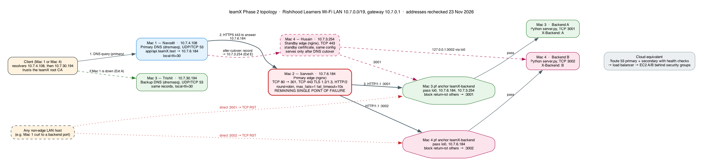

# Private Network Service Platform - CN Project

A local Computer Networks course project built from four Macs on one private
LAN. Clients resolve a `.test` hostname through the team's DNS server, establish
HTTPS with the NGINX edge, and receive JSON from one of two HTTP backends. The
project demonstrates DNS, TCP, TLS, HTTP, load balancing, caching, and packet
analysis without cloud hosting.

## Architecture



| Machine | Owner | Shared role | Recorded IPv4 | Service ports | Cloud equivalent |
| --- | --- | --- | --- | --- | --- |
| Mac 1 | Navodit | Private DNS and test client | `10.7.10.22` | UDP/TCP 53 | Managed private DNS |
| Mac 2 | Sarvesh | HTTPS edge, reverse proxy, load balancer | `10.7.22.227` | TCP 80 and 443 | Application load balancer |
| Mac 3 | Trishit | Backend A | `10.7.18.190` | TCP 3001 | Application server A |
| Mac 4 | Husain | Backend B and test client | `10.7.24.166` | TCP 3002 | Application server B |

These addresses were recorded on 28 September 2026. All four machines use
`10.7.0.0/19` with gateway `10.7.0.1`; recheck addresses before another run.
The [IP and service inventory](01_architecture/ip_table.md) includes interfaces,
masks, MAC addresses, and collection commands.

Both `app.teamX.test` and `api.teamX.test` resolve to Mac 2 with a configured
60-second TTL. They use the same NGINX server block and backend pool. DNS
returns the edge address; NGINX selects the backend for each proxied request.

For a fresh connection, the request follows these steps:

1. The client asks Mac 1 for the hostname's A record.
2. The client and Mac 2 exchange TCP SYN, SYN-ACK, and ACK on destination port 443.
3. TLS authenticates the edge certificate against the team root CA and establishes encryption.
4. NGINX receives the encrypted HTTP request and forwards it over HTTP/1.1 to Backend A or B.
5. The backend returns JSON and `X-Backend`; NGINX returns the response over TLS.

DNS answers and established connections can be reused. The
[architecture document](01_architecture/architecture_doc.md#5-components-and-request-path)
shows the full sequence, protocol layers, ports, and the TLS termination boundary.

## Repository structure

```text
CN/
├── README.md
├── AGENTS.md
├── .gitignore
├── 01_architecture/
├── 02_config/
├── 03_backend_code/
├── 04_evidence/
└── 06_phase1_checklists/
```

| Location | Contents |
| --- | --- |
| [01_architecture](01_architecture/) | Architecture document, topology, IP/service table, and request-flow diagrams |
| [02_config](02_config/) | dnsmasq and NGINX configuration, TLS setup notes, public root CA, and edge setup helper |
| [03_backend_code](03_backend_code/) | Shared Python backend and A/B launch instructions |
| [04_evidence](04_evidence/) | Saved screenshots and original packet captures, grouped by rubric task |
| [06_phase1_checklists](06_phase1_checklists/team_overview.md) | Team progress, role guides, remaining checks, demonstration order, and viva preparation |

## Requirements and shared setup

- Four Macs on the same private Wi-Fi/LAN, with connectivity between the project ports.
- Python 3 on both backend machines; the application uses only the standard library.
- dnsmasq on the DNS machine, plus NGINX with HTTP/2 support and OpenSSL 3 on the edge.
- `dig` or `nslookup`, `curl`, and Wireshark or `tcpdump` for verification and evidence.
- Administrator access on machines that configure DNS, bind privileged ports, or install client certificate trust.

Use the configuration bundle and role guides for machine setup:

1. Confirm the LAN and inventory using [Task A and the team gates](06_phase1_checklists/team_overview.md).
2. Configure Mac 1 from [dnsmasq-teamX.conf](02_config/dnsmasq-teamX.conf) and
   [DNS notes](02_config/dnsmasq-teamX.md). At least two other Macs must use Mac 1 as their resolver.
3. Start both backends using the commands below, then check reachability from Mac 2.
4. Configure Mac 2 using [nginx-teamX.conf](02_config/nginx-teamX.conf) and
   [TLS setup notes](02_config/tls_setup_notes.md), then configure client trust.

The NGINX file is a site configuration included from NGINX's `http` context.
It contains paths from the recorded edge machine; certificate and log paths
must match the machine running the edge. The public
[team root CA](02_config/teamX-rootCA.crt) is included. The server certificate
and private keys remain outside the repository, so a checkout alone cannot
start HTTPS. The existing [edge setup helper](02_config/mac2-edge-setup.sh)
generates certificates and writes configuration; review its effects before use.

Current service ports are 80/443. The rubric permits 8080/8443 when privileged
ports are unavailable, but that requires coordinated configuration, URL, and
evidence updates. Keep the `.test` namespace; the course excludes `.local`
because it conflicts with macOS mDNS.

### Start the backends

Run from the repository root on each assigned machine:

**Backend A (Mac 3):**

```sh
BACKEND_ID=A PORT=3001 python3 03_backend_code/server.py
```

**Backend B (Mac 4):**

```sh
BACKEND_ID=B PORT=3002 python3 03_backend_code/server.py
```

Both processes bind to `0.0.0.0`. `BACKEND_ID` and `PORT` are required.
See the [backend README](03_backend_code/README.md) for local checks and
direct connectivity checks from the edge. Client application requests use the
edge hostname.

## HTTP interface and edge behavior

| Method and path | Response | Cache policy |
| --- | --- | --- |
| `GET /` | JSON service information | `no-store` |
| `GET /api/status` | JSON status, backend identity, port, and UTC time | `no-store` |
| `GET /api/cached` | Identical cacheable JSON on both backends | `public, max-age=60` with a stable ETag |
| `HEAD` on these paths | Corresponding headers without a body | Same policy as GET |

Unknown paths return JSON with HTTP 404. Backend responses expose
`X-Backend: A` or `X-Backend: B`. NGINX adds `X-Edge: mac2-nginx` and
`X-Upstream-Addr`, and records upstream addresses/statuses in its access log.

NGINX redirects HTTP on port 80 to HTTPS. It enables HTTP/2 for compatible
clients and TLS 1.2/1.3; the upstream hop is plaintext HTTP/1.1. Round-robin
selection distributes requests between A and B. Passive failure handling uses
`max_fails=1`, `fail_timeout=10s`, a two-second connect timeout, and configured
upstream retry conditions. DNS and the edge remain single points of failure.
See [NGINX's balancing documentation](https://nginx.org/en/docs/http/load_balancing.html)
for the selection and passive failure model.

`/api/cached` returns the same representation and ETag from either backend.
A matching `If-None-Match` request receives HTTP 304 without a body. A fresh
client cache hit reuses content without a network request; revalidation sends
a conditional request; a full response transfers the body. NGINX proxy caching
is not configured.

## Verify through the hostname

After the services and client resolver are configured, run these checks from a
client, using the repository root as the working directory:

```sh
dig app.teamX.test
dig api.teamX.test
curl --cacert 02_config/teamX-rootCA.crt -i https://app.teamX.test/api/status

for attempt in 1 2 3 4 5 6; do
  curl --cacert 02_config/teamX-rootCA.crt -sS -D - -o /dev/null \
    https://app.teamX.test/api/status
done

curl --cacert 02_config/teamX-rootCA.crt --http1.1 -I https://app.teamX.test/api/status
curl --cacert 02_config/teamX-rootCA.crt -I https://app.teamX.test/api/cached
```

Expected results are Mac 2's A record, trusted HTTPS with HTTP 200, both
backend identities across repeated requests, and cache headers on
`/api/cached`. A curl build with HTTP/2 support can use `--http2` to request
HTTP/2; confirm the negotiated version in the response.

Copy the exact ETag from the cache response, including its quotes, into a
conditional request:

```sh
curl --cacert 02_config/teamX-rootCA.crt -i \
  -H 'If-None-Match: "paste-etag-here"' https://app.teamX.test/api/cached
```

The matching response should be `304 Not Modified` with no body.
`--cacert` validates the certificate using the supplied CA. Configure browser
trust using the TLS notes; the final demonstration must not use `curl -k`.
Avoid `--resolve` for DNS evidence because it bypasses DNS lookup.

## Submission and evidence map

Review 1 awards 40 team marks plus 10 individual viva marks per student.
The table maps the rubric to existing deliverables and evidence folders;
saved artifacts are historical evidence, not a current service-health check.

| Review 1 area | Marks | Deliverable and evidence location |
| --- | ---: | --- |
| LAN and private DNS (A/B) | 10 | [Topology and inventory](01_architecture/), [DNS config](02_config/dnsmasq-teamX.conf), [LAN evidence](04_evidence/A_lan/), [DNS evidence](04_evidence/B_dns/) |
| Backends, proxy, and balancing (C/D) | 10 | [Backend source](03_backend_code/server.py), [NGINX config](02_config/nginx-teamX.conf), [backend evidence](04_evidence/C_backends/), [balancing evidence](04_evidence/D_loadbalancing/) |
| HTTPS and TLS (E) | 8 | [TLS notes](02_config/tls_setup_notes.md), [TLS evidence](04_evidence/E_tls/) |
| Packet analysis and protocol flow (G) | 7 | [Request sequence](01_architecture/architecture_doc.md#5-components-and-request-path), [screenshots and original captures](04_evidence/G_protocol_flow/) |
| Caching and transport understanding (F) | 5 | [Backend caching contract](03_backend_code/README.md), [cache evidence](04_evidence/F_caching/) |
| Individual Phase 1 viva | 10 | [Shared demonstration and viva guide](06_phase1_checklists/team_overview.md) |

Required failure evidence is in [H_failures](04_evidence/H_failures/): wrong
DNS server, wrong DNS record, one backend stopped, both backends stopped, and
wrong destination port. Each demonstration must show the failing layer and
restoration. One stopped backend should leave service available through the
other; both stopped backends produce an upstream failure at the reachable edge.

The team checklist records the Phase 1 gate and saved evidence. It still lists
a client lookup of `api.teamX.test` and a Backend A stop/recovery demonstration
from Mac 1 or Mac 4 as pending, along with final packaging and rehearsal.
Use that checklist for current progress; this README does not certify a live
demonstration or mark those items complete.

For the protocol walkthrough, open the
[TLS 1.2 capture](04_evidence/G_protocol_flow/G_capture3_tls12.pcapng) or
[TLS 1.3 capture](04_evidence/G_protocol_flow/G_capture2_tls13.pcapng) and identify
DNS, TCP flags, source/destination ports, TLS messages, and encrypted application
data. HTTP headers are visible in client output; HTTPS payloads are encrypted
in the capture. TLS 1.3 also encrypts the certificate message. A client capture
does not necessarily include the separate edge-to-backend hop on a switched LAN.

Phase 2 adds backup DNS, TTL changes, backend isolation, further failover,
edge migration, troubleshooting, and a final report. Those extensions belong
to the later review and are outside this Phase 1 documentation update.
